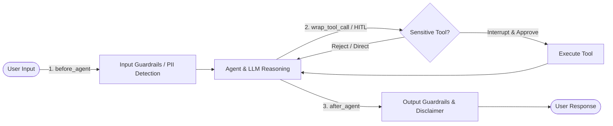

# LangChain Guardrails — Revision & Practice 🛡️

> Concise revision notes, architectural explanations, runnable examples, and practice tasks for securing LangChain agents using deterministic checks, model-based filtering, and middleware guardrails.

---

## 1. What are Guardrails?

**Guardrails** are programmatic validation and filtering barriers that inspect, sanitize, modify, or block an agent's:
1. **Inputs**: Prompt injections, jailbreaks, banned topics, PII leaking into the prompt.
2. **Tool Invocations**: Unauthorized actions, sensitive operations without approval, parameter tampering.
3. **Outputs**: Hallucinated compliance claims, PII leaks, brand safety violations, missing disclaimers.

In modern LangChain, guardrails are typically introduced as **middleware** passed to `create_agent(..., middleware=[...])`.



### Common Use Cases:
- **Protect Personally Identifiable Information (PII)**: Redact or mask emails, credit card numbers, phone numbers, SSNs, and API keys.
- **Block Disallowed Requests**: Catch prompt exploits, forbidden keywords, or toxic prompts before they reach the model.
- **Human-in-the-Loop (HITL)**: Require human authorization before sensitive tool executions (e.g., executing transactions, deleting databases, sending external emails).
- **Inspect & Modify Final Responses**: Append mandatory legal disclaimers, verify factuality, or redact residual sensitive output.

---

## 2. Deterministic vs. Model-Based Guardrails

Guardrails generally belong to one of two categories:

| Approach | How It Works | Strengths | Limitations | Ideal Use Case |
| :--- | :--- | :--- | :--- | :--- |
| **Deterministic** | Regex, keyword blocklists, schema checks, exact rules | ⚡ Ultra-fast, zero token cost, 100% predictable, easy auditability | Cannot understand nuance, context, rephrasings, or semantic obfuscation | Exact PII matching, forbidden words, structural bounds, API key leaks |
| **Model-Based** | A secondary LLM / classifier evaluates semantic intent | 🧠 Catches subtle attacks, complex jailbreaks, intent variations | ⏱️ Slower, incurs token costs, can still produce false positives/negatives | Jailbreak defense, semantic policy moderation, tone & sentiment evaluation |

> [!TIP]
> **Defense in Depth**: A best practice in production is **layering**. Run inexpensive, deterministic checks first (to fail fast with minimal latency/cost). Only fall back to model-based evaluators when semantic judgment is strictly necessary.

---

## 3. Setup & Environment

The examples in this guide demonstrate both `langchain-openai` and standard LangChain ecosystem dependencies.

### Installation
```bash
uv add langchain langgraph langchain-openai python-dotenv
# Alternatively with pip:
# pip install langchain langgraph langchain-openai python-dotenv
```

### Environment Configuration (`.env`)
Create a `.env` file in your project root:
```env
OPENAI_API_KEY=your_api_key_here
```

Load environment variables in your scripts using:
```python
from dotenv import load_dotenv
load_dotenv()
```

> [!CAUTION]
> Never commit `.env` or real API keys to version control. Always include `.env` in your `.gitignore`.

---

## 4. PII Detection (`PIIMiddleware`)

`PIIMiddleware` detects sensitive data at configured lifecycle boundaries and applies a remediation strategy.

### Supported Strategies

| Strategy | Behavior | Example Transformation |
| :--- | :--- | :--- |
| **`redact`** | Replaces matching sensitive data with a typed placeholder marker | `john@example.com` → `[REDACTED_EMAIL]` |
| **`mask`** | Partially obscures the value to obscure details while preserving structure | `5105-1051-0510-5100` → `5105-****-****-5100` |
| **`hash`** | Replaces the value with a deterministic one-way hash | Consistent tokenization across requests |
| **`block`** | Immediately raises an error or halts execution when detected | Aborts request if secret credentials are exposed |

### Built-in Types & Custom Detectors
- **Built-in types**: `email`, `credit_card`, `ip`, `mac_address`, `url`.
- **Custom detector**: Provide custom regex patterns via `detector=r"..."` for credentials (e.g., API keys, internal IDs).

### Target Boundaries
- `apply_to_input=True`: Checks user messages coming into the agent.
- `apply_to_output=True`: Checks assistant responses before they are returned.
- `apply_to_tool_results=True`: Checks raw outputs returned by external tools.

### Code Example: PII Sanitization & API Key Blocking

```python
from langchain.agents import create_agent
from langchain.agents.middleware import PIIMiddleware
from langchain.tools import tool
from langchain_openai import ChatOpenAI

@tool
def customer_lookup(query: str) -> str:
    """Look up a customer record."""
    return f"Customer record found for: {query}"

agent = create_agent(
    model=ChatOpenAI(model="gpt-4o-mini", temperature=0),
    tools=[customer_lookup],
    middleware=[
        # Redact emails in input
        PIIMiddleware("email", strategy="redact", apply_to_input=True),
        # Mask credit cards in input
        PIIMiddleware("credit_card", strategy="mask", apply_to_input=True),
        # Block OpenAI API keys matching regex
        PIIMiddleware(
            "api_key",
            detector=r"sk-[a-zA-Z0-9]{32}",
            strategy="block",
            apply_to_input=True,
        ),
    ],
)

result = agent.invoke({
    "messages": [{
        "role": "user",
        "content": "My email is john.doe@example.com and my card is 5105-1051-0510-5100."
    }]
})

print(result["messages"][-1].content)
```

---

## 5. Human-in-the-Loop (HITL) Guardrail

Use `HumanInTheLoopMiddleware` when sensitive tool calls require explicit human review and authorization (e.g., sending emails, deleting data, transferring funds).

> [!IMPORTANT]
> **Key Rules for HITL Execution**:
> 1. **Checkpointer Required**: You must provide a state checkpointer such as `InMemorySaver()`.
> 2. **Session Thread ID**: A unique `thread_id` inside `config={"configurable": {"thread_id": "..."}}` is mandatory so state can pause and resume in the exact same execution context.
> 3. **Inspect `__interrupt__`**: Invoke the agent first; if an interrupt triggered, inspect `result["__interrupt__"]`.
> 4. **Resume with `Command`**: Resume by invoking the agent with `Command(resume=...)` using the exact same config and thread ID.
> 5. **Tool Invocations Only**: The interrupt occurs **only** when the LLM actually decides to invoke a tool flagged as `True` in `interrupt_on`.

### Code Example: Approving / Rejecting an Action

```python
from langchain.agents import create_agent
from langchain.agents.middleware import HumanInTheLoopMiddleware
from langchain.tools import tool
from langchain_openai import ChatOpenAI
from langgraph.checkpoint.memory import InMemorySaver
from langgraph.types import Command

@tool
def search_web(query: str) -> str:
    """Search for information. Mock tool."""
    return f"Search results for: {query}"

@tool
def send_email(to: str, subject: str, body: str) -> str:
    """Send an email. Mock tool."""
    return f"Email sent to {to} with subject: {subject}"

# Configure agent with HITL guardrail
agent = create_agent(
    model=ChatOpenAI(model="gpt-4o-mini", temperature=0),
    tools=[search_web, send_email],
    middleware=[
        HumanInTheLoopMiddleware(
            interrupt_on={"send_email": True, "search_web": False}
        )
    ],
    checkpointer=InMemorySaver(),
)

config = {"configurable": {"thread_id": "email-session-001"}}

# Step 1: Initial invocation triggers an interrupt before send_email
result = agent.invoke(
    {"messages": [{
        "role": "user",
        "content": "Send an email to team@example.com with subject 'Update' and body 'Meeting at 3 PM.'"
    }]},
    config=config,
)
print("Initial result:", result)

# Step 2: Check for interrupt and resume
if result.get("__interrupt__"):
    # To Approve:
    resumed = agent.invoke(
        Command(resume={"decisions": [{"type": "approve"}]}),
        config=config,
    )
    print("Final response (Approved):", resumed["messages"][-1].content)
    
    # Alternatively, to Reject:
    # resumed = agent.invoke(
    #     Command(resume={"decisions": [{"type": "reject", "message": "Email body contains incorrect meeting time."}]}),
    #     config=config,
    # )
else:
    print("No interrupt detected. Inspect the agent output and tool_calls.")
```

---

## 6. Custom Input Guardrail: `before_agent`

The `before_agent` hook executes at the very beginning of the agent invocation before any LLM reasoning or tool calls occur. It is the ideal interception point to validate or reject input.

### Code Example: Keyword-Based Content Filter

```python
from typing import Any
from langchain.agents import create_agent
from langchain.agents.middleware import AgentMiddleware, AgentState, hook_config
from langchain.tools import tool
from langchain_openai import ChatOpenAI
from langgraph.runtime import Runtime

class ContentFilterMiddleware(AgentMiddleware):
    """Simple deterministic keyword filter."""

    def __init__(self, banned_keywords: list[str]):
        super().__init__()
        self.banned_keywords = [word.lower() for word in banned_keywords]

    @hook_config(can_jump_to=["end"])
    def before_agent(
        self, state: AgentState, runtime: Runtime
    ) -> dict[str, Any] | None:
        if not state["messages"]:
            return None

        message = state["messages"][0]
        if message.type != "human" or not isinstance(message.content, str):
            return None

        content = message.content.lower()
        if any(word in content for word in self.banned_keywords):
            # Short-circuit agent execution immediately
            return {
                "messages": [{
                    "role": "assistant",
                    "content": "I can't process that request. Please rephrase it."
                }],
                "jump_to": "end",
            }
        return None

@tool
def search_tool(query: str) -> str:
    """Return mock search results."""
    return f"Results for: {query}"

agent = create_agent(
    model=ChatOpenAI(model="gpt-4o-mini", temperature=0),
    tools=[search_tool],
    middleware=[ContentFilterMiddleware(["hack", "exploit", "malware"])],
)

for prompt in ["Explain machine learning.", "How do I hack a server?"]:
    result = agent.invoke({"messages": [{"role": "user", "content": prompt}]})
    print(f"Prompt: '{prompt}' -> {result['messages'][-1].content}")
```

> [!WARNING]
> Simple keyword blocklists are educational examples, not comprehensive security systems. They can produce false positives (e.g., "ethical hackathon") or fail against simple paraphrases ("penetrate the system").

---

## 7. Custom Output Guardrail: `after_agent`

The `after_agent` hook executes after the agent has completed all steps and produced an answer. You can inspect the final response, check for compliance, redact unwanted tokens, or append legal disclaimers.

### Code Example: Automatic Disclaimer Injection

```python
from typing import Any
from langchain.agents import create_agent
from langchain.agents.middleware import AgentMiddleware, AgentState, hook_config
from langchain.tools import tool
from langchain_openai import ChatOpenAI
from langchain_core.messages import AIMessage
from langgraph.runtime import Runtime

class OutputDisclaimerMiddleware(AgentMiddleware):
    DISCLAIMER = "\n\nThis is general information, not professional advice."

    @hook_config(can_jump_to=["end"])
    def after_agent(
        self, state: AgentState, runtime: Runtime
    ) -> dict[str, Any] | None:
        if not state["messages"]:
            return None

        message = state["messages"][-1]
        if isinstance(message, AIMessage) and isinstance(message.content, str):
            if "not professional advice" not in message.content.lower():
                message.content += self.DISCLAIMER
        return None

@tool
def general_tool(query: str) -> str:
    """Return a mock result."""
    return f"Information about: {query}"

agent = create_agent(
    model=ChatOpenAI(model="gpt-4o-mini", temperature=0),
    tools=[general_tool],
    middleware=[OutputDisclaimerMiddleware()],
)

result = agent.invoke({
    "messages": [{"role": "user", "content": "Explain regular exercise."}]
})
print(result["messages"][-1].content)
```

---

## 8. Full Combined Practice Pipeline

This end-to-end example unites:
1. **Input Content Filtering**: Intercepts banned security terms early via `before_agent`.
2. **PII Sanitization**: Redacts emails and masks credit cards on user input.
3. **HITL Supervision**: Pauses and asks for user approval before sending emails.
4. **Output Compliance**: Enforces an informative disclaimer via `after_agent`.

```python
import os
from typing import Any

from dotenv import load_dotenv
from langchain.agents import create_agent
from langchain.agents.middleware import (
    AgentMiddleware, AgentState, PIIMiddleware,
    HumanInTheLoopMiddleware, hook_config,
)
from langchain.tools import tool
from langchain_openai import ChatOpenAI
from langchain_core.messages import AIMessage
from langgraph.checkpoint.memory import InMemorySaver
from langgraph.runtime import Runtime
from langgraph.types import Command

load_dotenv()
if not os.getenv("OPENAI_API_KEY"):
    raise ValueError("Set OPENAI_API_KEY in your .env file.")

# 1. Custom Input Filter
class ContentFilterMiddleware(AgentMiddleware):
    def __init__(self, banned_keywords: list[str]):
        super().__init__()
        self.banned_keywords = [word.lower() for word in banned_keywords]

    @hook_config(can_jump_to=["end"])
    def before_agent(
        self, state: AgentState, runtime: Runtime
    ) -> dict[str, Any] | None:
        if not state["messages"]:
            return None
        message = state["messages"][0]
        if message.type != "human" or not isinstance(message.content, str):
            return None
        content = message.content.lower()
        if any(word in content for word in self.banned_keywords):
            return {
                "messages": [{
                    "role": "assistant",
                    "content": "I can't process that request. Please rephrase it."
                }],
                "jump_to": "end",
            }
        return None

# 2. Custom Output Disclaimer
class OutputDisclaimerMiddleware(AgentMiddleware):
    DISCLAIMER = "\n\nNote: This is general information, not professional advice."

    @hook_config(can_jump_to=["end"])
    def after_agent(
        self, state: AgentState, runtime: Runtime
    ) -> dict[str, Any] | None:
        if not state["messages"]:
            return None
        message = state["messages"][-1]
        if isinstance(message, AIMessage) and isinstance(message.content, str):
            if "not professional advice" not in message.content.lower():
                message.content += self.DISCLAIMER
        return None

# 3. Tools
@tool
def search_tool(query: str) -> str:
    """Search for information. Mock implementation."""
    return f"Search results for: {query}"

@tool
def send_email_tool(to: str, subject: str, body: str) -> str:
    """Send an email. Mock implementation; no real email is sent."""
    return f"Email sent to {to} with subject: {subject}"

# 4. Agent Assembly with Layered Middleware
agent = create_agent(
    model=ChatOpenAI(model="gpt-4o-mini", temperature=0),
    tools=[search_tool, send_email_tool],
    middleware=[
        ContentFilterMiddleware(["malware", "exploit"]),
        PIIMiddleware("email", strategy="redact", apply_to_input=True),
        PIIMiddleware("credit_card", strategy="mask", apply_to_input=True),
        HumanInTheLoopMiddleware(
            interrupt_on={"send_email_tool": True, "search_tool": False}
        ),
        OutputDisclaimerMiddleware(),
    ],
    checkpointer=InMemorySaver(),
)

# 5. Invocation and Interactive Approval
config = {"configurable": {"thread_id": "guardrails-practice-001"}}

result = agent.invoke(
    {"messages": [{
        "role": "user",
        "content": (
            "Send an email to team@example.com with subject 'Meeting' "
            "and body 'The meeting is at 3 PM.'"
        )
    }]},
    config=config,
)
print("Initial result:", result)

if result.get("__interrupt__"):
    choice = input("Approve email? Type yes or no: ").strip().lower()
    if choice == "yes":
        decision = {"type": "approve"}
    else:
        decision = {"type": "reject", "message": "Rejected during human review."}

    final_result = agent.invoke(
        Command(resume={"decisions": [decision]}),
        config=config,
    )
    print("\nFinal response:\n", final_result["messages"][-1].content)
else:
    print("No interrupt detected. Check whether send_email_tool was called.")
```

---

## 9. Revision Summary Table

| Guardrail | Where It Runs | Main Purpose | Configuration Hook / Class |
| :--- | :--- | :--- | :--- |
| **`PIIMiddleware`** | Configured input, output, or tool-result boundaries | Detect, redact, mask, hash, or block sensitive personal information | `PIIMiddleware(entity_type, strategy="...")` |
| **`HumanInTheLoopMiddleware`** | Before configured tool invocation | Pause execution and require human review (approve/edit/reject) | `HumanInTheLoopMiddleware(interrupt_on={...})` + `checkpointer` |
| **`before_agent`** | At start of invocation, before LLM execution | Validate input, block malicious prompt keywords, short-circuit early | `def before_agent(self, state, runtime)` with `@hook_config` |
| **`after_agent`** | At end of invocation, after LLM completes | Inspect final output, inject compliance disclaimers, verify safety | `def after_agent(self, state, runtime)` with `@hook_config` |
| **Layered Middleware** | Multiple stages across the lifecycle | Defense-in-depth: combine fast deterministic checks with semantic governance | Passed sequentially to `create_agent(middleware=[...])` |

---

## 10. Practice Checklist

Use this checklist to test and verify your guardrail implementations:

- [ ] **Deterministic vs. Model-based**: Explain trade-offs regarding cost, latency, nuance, and false positive rates.
- [ ] **Banned Keyword Filtering**: Add and test new banned keywords (e.g., `ddos`, `ransomware`) inside `ContentFilterMiddleware`.
- [ ] **PII Strategies**: Switch `PIIMiddleware` strategy between `redact`, `mask`, `hash`, and `block` and observe output differences.
- [ ] **HITL Approval vs. Rejection**: Test both approval (`{"type": "approve"}`) and rejection (`{"type": "reject", "message": "..."}`) paths for `send_email_tool`.
- [ ] **Interrupt Inspection**: Print the raw agent state when paused and locate the `__interrupt__` key.
- [ ] **State Persistence**: Verify why both a checkpointer (`InMemorySaver`) and a `thread_id` are essential for resuming executions.
- [ ] **Custom Business Rule**: Write a `before_agent` check enforcing message length or business-specific constraints.
- [ ] **Output Verification**: Implement an `after_agent` check that validates tone or checks for forbidden words in assistant responses.
- [ ] **Limitations Awareness**: Articulate why keyword filtering and output disclaimers alone do not replace comprehensive application security.

---

## 11. Interview Revision Q&A

### Q1: What are guardrails in AI agent workflows?
> **Answer**: Guardrails are programmable validation barriers that inspect, sanitize, alter, or block inputs, tool executions, and outputs to prevent unintended behavior, mitigate jailbreaks, and protect sensitive data.

### Q2: What is the difference between deterministic and model-based guardrails?
> **Answer**: Deterministic guardrails (regex, keywords, schema validation) are fast, zero-token cost, and strictly predictable, but miss nuanced semantic context. Model-based guardrails use an LLM or classifier to understand context and intent, but add latency, token cost, and potential non-determinism.

### Q3: Why and when should you use `PIIMiddleware`?
> **Answer**: To prevent sensitive personal data (emails, credit cards, IP addresses, credentials) from leaking into external model training/logs (via input masking/redaction) or leaking out to end users (via output inspection).

### Q4: How does Human-in-the-Loop (HITL) protect sensitive operations?
> **Answer**: It intercepts tool invocations before execution, pauses the LangGraph execution flow, stores state via a checkpointer, and awaits an external decision (`approve`, `edit`, `reject`) before continuing.

### Q5: Why are a checkpointer and a `thread_id` mandatory for HITL?
> **Answer**: When an interrupt occurs, the execution thread stops. The checkpointer serializes the graph state, and the `thread_id` acts as the primary key identifying which paused conversation session is being resumed when `Command(resume=...)` is invoked.

### Q6: What is the distinction between `before_agent` and `after_agent`?
> **Answer**: `before_agent` runs before the agent loop begins (ideal for validating or rejecting user prompt inputs early). `after_agent` runs after the agent completes all iterations and tools (ideal for post-processing the final response, compliance checks, or disclaimers).

### Q7: Why is layering middleware (defense in depth) considered best practice?
> **Answer**: No single check is foolproof. Deterministic checks handle rapid, low-cost baseline filtering; tool-level HITL middleware prevents dangerous real-world side effects; and output middleware enforces regulatory and compliance standards.
