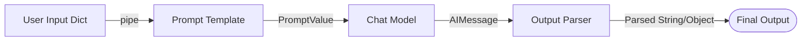

# LangChain LCEL — Revision and Practice Notes ⚡🔗

> **Goal:** Understand LangChain Expression Language (LCEL), revise the core Runnable building blocks, and practice composing chains in Python — with a dedicated focus on composing **Retrieval-Augmented Generation (RAG)** pipelines.
>
> **Audience:** Beginner to intermediate LangChain learner preparing for hands-on projects and interviews.
>
> **Version note:** LangChain APIs evolve. The examples use the modern `langchain_core` Runnable interfaces and common LCEL patterns. Check the official docs for your installed versions.

---

## 📑 Contents

1. [What is LCEL?](#1-what-is-lcel)
2. [The Pipe Operator (`|`)](#2-the-pipe-operator-)
   - [Execution Flow](#execution-flow)
   - [Complete Example: Prompt → Model → Parser](#complete-example-prompt--model--parser)
3. [Runnable Methods: `invoke`, `batch`, and `stream`](#3-runnable-methods-invoke-batch-and-stream)
   - [`invoke(input)`](#invokeinput)
   - [`batch(inputs)`](#batchinputs)
   - [`stream(input)`](#streaminput)
4. [Core Runnable Building Blocks](#4-core-runnable-building-blocks)
   - [4.1 `RunnableSequence`](#41-runnablesequence)
   - [4.2 `RunnableParallel`](#42-runnableparallel)
   - [4.3 `RunnablePassthrough`](#43-runnablepassthrough)
   - [4.4 `RunnableLambda`](#44-runnablelambda)
   - [4.5 `RunnableBranch`](#45-runnablebranch)
5. [Practical LCEL Chain with Custom Preprocessing](#5-a-practical-lcel-chain-with-custom-preprocessing)
6. [LCEL for RAG (Retrieval-Augmented Generation)](#6-lcel-for-rag-retrieval-augmented-generation)
   - [The Standard LCEL RAG Composition Pattern](#61-the-standard-lcel-rag-composition-pattern)
   - [Multi-Branch Parallel Retrieval with LCEL](#62-multi-branch-parallel-retrieval-with-lcel)
   - [Query Routing with `RunnableBranch` in RAG](#63-query-routing-with-runnablebranch-in-rag)
7. [LCEL and Memory / Conversational State](#7-lcel-and-memorystate)
8. [Common Mistakes and Debugging](#8-common-mistakes-and-debugging)
9. [Practice Exercises](#9-practice-exercises)
10. [Mini-Project: QA Study Assistant using LCEL](#10-mini-project-qa-study-assistant-using-lcel)
11. [Interview Questions](#11-interview-questions)
12. [Quick Revision Sheet](#12-quick-revision-sheet)
13. [Official References](#13-official-references)

---

## 1. What is LCEL?

**LCEL (LangChain Expression Language)** is a declarative syntax for composing LangChain components into a unified, executable pipeline. It connects prompts, models, parsers, retrievers, and custom Python functions using the unix-style pipe operator (`|`).

Think of LCEL as an assembly line:

$$\text{Input} \longrightarrow \text{Prompt} \longrightarrow \text{Chat Model} \longrightarrow \text{Output Parser} \longrightarrow \text{Result}$$

Each step receives the output of the preceding step and forwards its own transformed output to the next step.



### Why use LCEL?

- **Composition:** Connect modular components without writing custom orchestration boilerplate.
- **Readability:** The end-to-end execution order is visible at a glance in a single concise expression.
- **Unified Runnable Interface:** Every LCEL chain automatically inherits synchronous (`invoke`), batched (`batch`), and streaming (`stream`) execution, plus async equivalents (`ainvoke`, `abatch`, `astream`).
- **Parallel Execution:** Seamlessly execute independent branches simultaneously using `RunnableParallel`.
- **Custom Logic Integration:** Wrap arbitrary Python callables using `RunnableLambda` without breaking chain composability.
- **Maintainability & Modularity:** Swap models, prompt templates, or vector retrievers with zero changes to surrounding application code.

---

## 2. The Pipe Operator (`|`)

The pipe operator connects one `Runnable` component to another.

```python
chain = prompt | model | parser
```

### Execution Flow

1. `prompt` receives the input dictionary and renders a formatted `PromptValue`.
2. `model` receives that `PromptValue` and returns an `AIMessage`.
3. `parser` extracts the text or structured content from `AIMessage`, returning a clean string or dictionary.

### Complete Example: Prompt → Model → Parser

Install dependencies and set up your environment:

```bash
pip install -U langchain-core langchain-openai python-dotenv
```

```python
import os
from dotenv import load_dotenv
from langchain_core.prompts import ChatPromptTemplate
from langchain_core.output_parsers import StrOutputParser
from langchain_openai import ChatOpenAI

load_dotenv()

# 1. Define prompt template
prompt = ChatPromptTemplate.from_template(
    "Explain {topic} in simple terms and give one example."
)

# 2. Initialize chat model
model = ChatOpenAI(model="gpt-4o-mini", temperature=0)

# 3. Initialize output parser
parser = StrOutputParser()

# 4. Compose the pipeline with LCEL
chain = prompt | model | parser

# 5. Invoke the chain
result = chain.invoke({"topic": "LCEL"})
print(result)
```

**Expected behavior:** The model returns a concise plain-text explanation of LCEL.

---

## 3. Runnable Methods: `invoke`, `batch`, and `stream`

Every LCEL chain implements the standard `Runnable` protocol:

### `invoke(input)`

Executes the chain synchronously for a single input dictionary or value.

```python
answer = chain.invoke({"topic": "embeddings"})
print(answer)
```

### `batch(inputs)`

Runs the chain across multiple inputs. Under the hood, LangChain optimizes batch execution using thread pools or provider batch APIs:

```python
questions = [
    {"topic": "retrieval"},
    {"topic": "embeddings"},
    {"topic": "vector stores"},
]

answers = chain.batch(questions)

for question, answer in zip(questions, answers):
    print("TOPIC:", question["topic"])
    print("ANSWER:", answer)
    print("-" * 40)
```

### `stream(input)`

Streams tokens chunk-by-chunk as they are produced by the LLM:

```python
for chunk in chain.stream({"topic": "semantic search"}):
    print(chunk, end="", flush=True)
print()
```

> [!NOTE]
> **Summary**:
> - `invoke`: Single synchronous call yielding the final result.
> - `batch`: Efficient batch processing across multiple inputs.
> - `stream`: Yields incremental token chunks for real-time UI display.
> - Async equivalents: `ainvoke`, `abatch`, `astream`, and `astream_events`.

---

## 4. Core Runnable Building Blocks

### 4.1 `RunnableSequence`

Runs components strictly in sequential order. The `|` operator is syntactic sugar that automatically constructs a `RunnableSequence`.

```python
from langchain_core.runnables import RunnableSequence

sequence = RunnableSequence(
    first=prompt,
    middle=[model],
    last=parser,
)

print(sequence.invoke({"topic": "RAG"}))
```

Use a sequence whenever the output of stage $N$ serves directly as the input to stage $N+1$.

### 4.2 `RunnableParallel`

Executes several Runnable branches simultaneously on the **same input** and merges their individual outputs into a dictionary keyed by branch name.

```python
from langchain_core.prompts import ChatPromptTemplate
from langchain_core.runnables import RunnableParallel
from langchain_core.output_parsers import StrOutputParser

short_prompt = ChatPromptTemplate.from_template("Summarize {text} in one sentence.")
keyword_prompt = ChatPromptTemplate.from_template("Extract up to five keywords from: {text}")

short_chain = short_prompt | model | StrOutputParser()
keyword_chain = keyword_prompt | model | StrOutputParser()

parallel_chain = RunnableParallel(
    summary=short_chain,
    keywords=keyword_chain,
)

result = parallel_chain.invoke({
    "text": "RAG retrieves relevant passages and supplies them to a language model."
})

print("SUMMARY:", result["summary"])
print("KEYWORDS:", result["keywords"])
```

**Output format:** `{"summary": "...", "keywords": "..."}`. Useful for performing multiple independent operations (e.g., summary + keyword extraction + sentiment analysis) in a single step.

### 4.3 `RunnablePassthrough`

Passes the input through without modification. It is crucial when an LCEL branch needs to preserve the original user input alongside newly generated context:

```python
from langchain_core.runnables import RunnablePassthrough, RunnableParallel

prepare = RunnableParallel(
    original_question=RunnablePassthrough(),
)

print(prepare.invoke("What is LCEL?"))
# Output: {"original_question": "What is LCEL?"}
```

> [!TIP]
> In dictionary pipelines, `RunnablePassthrough.assign(...)` allows you to append new keys to an existing dictionary without losing existing keys.

### 4.4 `RunnableLambda`

Wraps any custom Python function as a first-class `Runnable`, allowing preprocessing, validation, logging, or post-formatting inside an LCEL pipeline:

```python
from langchain_core.runnables import RunnableLambda

def normalize_topic(value: str) -> str:
    return value.strip().lower()

normalize = RunnableLambda(normalize_topic)

print(normalize.invoke("  LangChain LCEL  "))
# Output: "langchain lcel"
```

### 4.5 `RunnableBranch`

Provides deterministic conditional routing. It evaluates conditions in order and routes the input to the first matching branch, falling back to a default Runnable if none match:

```python
from langchain_core.runnables import RunnableBranch, RunnableLambda

def explain_python(text: str) -> str:
    return f"Python guidance: {text}"

def explain_sql(text: str) -> str:
    return f"SQL guidance: {text}"

router = RunnableBranch(
    (lambda x: "python" in x.lower(), RunnableLambda(explain_python)),
    (lambda x: "sql" in x.lower(), RunnableLambda(explain_sql)),
    RunnableLambda(lambda x: f"General QA guidance: {x}"),
)

print(router.invoke("I need Python testing help"))
print(router.invoke("Explain SQL joins"))
print(router.invoke("What is an API?"))
```

---

## 5. A Practical LCEL Chain with Custom Preprocessing

This end-to-end example normalizes user input, formats a QA prompt, invokes the model, and parses the output text:

```python
from langchain_core.prompts import ChatPromptTemplate
from langchain_core.runnables import RunnableLambda
from langchain_core.output_parsers import StrOutputParser
from langchain_openai import ChatOpenAI

# 1. Custom validation & normalization
def normalize_input(data: dict) -> dict:
    topic = data.get("topic", "").strip()
    if not topic:
        raise ValueError("Input 'topic' cannot be empty.")
    return {"topic": topic}

normalize = RunnableLambda(normalize_input)

# 2. Prompt targeting QA engineers
prompt = ChatPromptTemplate.from_template(
    "Explain {topic} to a junior QA engineer. Include one example and one test idea."
)

model = ChatOpenAI(model="gpt-4o-mini", temperature=0)

# 3. Compose pipeline
qa_chain = normalize | prompt | model | StrOutputParser()

# 4. Invoke
print(qa_chain.invoke({"topic": "  API status codes  "}))
```

### Step-by-Step Data Flow:
```text
{"topic": "  API status codes  "}
  │
  ▼ [normalize]
{"topic": "API status codes"}
  │
  ▼ [prompt]
PromptValue: "Explain API status codes to a junior QA engineer..."
  │
  ▼ [model]
AIMessage(content="API status codes are three-digit numbers...")
  │
  ▼ [StrOutputParser]
"API status codes are three-digit numbers..."
```

---

## 6. LCEL for RAG (Retrieval-Augmented Generation)

LCEL is the standard pattern for constructing modern RAG applications. It neatly solves the challenge of:
1. Passing the query to the retriever.
2. Formatting retrieved documents into a context string.
3. Preserving the original question for the prompt.

### 6.1 The Standard LCEL RAG Composition Pattern

```mermaid
flowchart TD
    Q([User Question: 'How many sick days?']) --> Fork{"LCEL Parallel Map"}
    Fork -->|retriever | format_docs| C[context: 'Full-time staff get 12 days...']
    Fork -->|RunnablePassthrough| QP[question: 'How many sick days?']
    C --> Prompt[ChatPromptTemplate]
    QP --> Prompt
    Prompt --> Model[Chat Model]
    Model --> Parser[StrOutputParser]
    Parser --> Out([Final Answer])
```

```python
from langchain_core.prompts import ChatPromptTemplate
from langchain_core.output_parsers import StrOutputParser
from langchain_core.runnables import RunnablePassthrough, RunnableLambda
from langchain_community.vectorstores import FAISS
from langchain_huggingface import HuggingFaceEmbeddings
from langchain_core.documents import Document
from langchain_openai import ChatOpenAI

# 1. Sample document corpus
docs = [
    Document(page_content="Full-time employees receive 12 sick-leave days per calendar year.", metadata={"source": "leave.txt"}),
    Document(page_content="Travel expense reports must be submitted within 30 days.", metadata={"source": "travel.txt"}),
]

embeddings = HuggingFaceEmbeddings(model_name="sentence-transformers/all-MiniLM-L6-v2")
vector_store = FAISS.from_documents(docs, embeddings)
retriever = vector_store.as_retriever(search_kwargs={"k": 2})

# 2. Document formatting helper
def format_docs(retrieved_documents: list[Document]) -> str:
    return "\n\n".join(
        f"[Source: {d.metadata.get('source')}] {d.page_content}"
        for d in retrieved_documents
    )

# 3. Strict prompt template
rag_prompt = ChatPromptTemplate.from_template("""
Answer the question based ONLY on the following context.
If the context does not contain the answer, say "I do not have enough information."

Context:
{context}

Question:
{question}
""")

model = ChatOpenAI(model="gpt-4o-mini", temperature=0)

# 4. Idiomatic LCEL RAG Chain
rag_chain = (
    {
        "context": retriever | RunnableLambda(format_docs),
        "question": RunnablePassthrough(),
    }
    | rag_prompt
    | model
    | StrOutputParser()
)

# 5. Invocation
answer = rag_chain.invoke("How many sick-leave days do employees get?")
print("RAG Answer:", answer)
```

### 6.2 Multi-Branch Parallel Retrieval with LCEL

When an application queries multiple independent knowledge bases (e.g., HR policy + IT documentation), LCEL allows parallel multi-store retrieval:

```python
from langchain_core.runnables import RunnableParallel

# Multi-source parallel context retrieval
multi_source_chain = (
    {
        "hr_context": hr_retriever | RunnableLambda(format_docs),
        "it_context": it_retriever | RunnableLambda(format_docs),
        "question": RunnablePassthrough(),
    }
    | multi_source_prompt
    | model
    | StrOutputParser()
)
```

### 6.3 Query Routing with `RunnableBranch` in RAG

Route queries to specialized knowledge retrievers based on topic keywords or classification:

```python
rag_router = RunnableBranch(
    (lambda q: "leave" in q.lower() or "vacation" in q.lower(), hr_rag_chain),
    (lambda q: "laptop" in q.lower() or "vpn" in q.lower(), it_rag_chain),
    general_faq_chain,  # default fallback
)
```

---

## 7. LCEL and Memory/State

LCEL composition by itself is **stateless**. Calling `chain.invoke()` multiple times does not automatically remember prior conversation turns.

To support multi-turn conversations in LCEL:
1. Use `MessagesPlaceholder` in your prompt.
2. Pass the list of previous messages explicitly in the invocation dictionary.

```python
from langchain_core.prompts import ChatPromptTemplate, MessagesPlaceholder
from langchain_core.messages import HumanMessage, AIMessage

chat_prompt = ChatPromptTemplate.from_messages([
    ("system", "You are a concise teaching assistant."),
    MessagesPlaceholder(variable_name="history"),
    ("human", "{question}"),
])

conversational_chain = chat_prompt | model | StrOutputParser()

# Managing conversation history explicitly:
history = [
    HumanMessage("Hi, my name is Viraj."),
    AIMessage("Hello Viraj! How can I help you today?"),
]

response = conversational_chain.invoke({
    "history": history,
    "question": "What is my name?"
})
print(response)  # Outputs: "Your name is Viraj."
```

> [!IMPORTANT]
> Passing history into a prompt provides the model with conversation context, but it does **not** persist it to disk or a database. For automated session persistence, use checkpointers (e.g. `InMemorySaver`, `PostgresSaver`) in LangGraph agents.

---

## 8. Common Mistakes and Debugging

| Issue | Cause | Fix |
| :--- | :--- | :--- |
| **Missing Prompt Variable** | Template expects `{topic}`, but dict provided `{"subject": "LCEL"}`. | Match dictionary keys exactly to template variable names. |
| **Output Type Mismatch** | Downstream step expects `str`, but `model` returns `AIMessage`. | Append `StrOutputParser()` directly after the model. |
| **Wrong Lambda Input** | `RunnableLambda` received output from prior pipe rather than root input. | Use `RunnableParallel` or `RunnablePassthrough` to preserve original input values. |
| **Branch Ordering Bug** | First matching condition in `RunnableBranch` always executes. | Order conditions from most specific to least specific. |
| **Missing API Key** | Environment variable missing or not loaded. | Call `load_dotenv()` or set `os.environ["OPENAI_API_KEY"]`. |
| **Stateless Assumption** | Expecting `.invoke()` to remember previous conversation turns. | Maintain message history list explicitly or use a checkpointer. |

---

## 9. Practice Exercises

### Exercise 1 — Basic Sequence
Create an LCEL chain that:
1. Accepts `{"name": "Viraj"}`.
2. Renders the prompt `"Write a friendly professional greeting for {name}."`
3. Calls a chat model.
4. Returns a plain string using `StrOutputParser`.

### Exercise 2 — Batch Revision
Use `chain.batch()` to explain three testing topics concurrently:
- Playwright page fixtures
- API HTTP status codes (2xx, 4xx, 5xx)
- RAG Faithfulness evaluation

Print each topic along with its response.

### Exercise 3 — Parallel Execution
Build a `RunnableParallel` pipeline with two independent branches:
- Branch A: Produces a 1-sentence executive summary of `{text}`.
- Branch B: Extracts up to 5 key technical terms from `{text}`.

Verify the output dictionary contains both `"summary"` and `"keywords"` keys.

### Exercise 4 — Custom Input Transformation
Write a `RunnableLambda` that:
1. Strips whitespace from user input.
2. Checks that the query length is at least 3 characters (raises an informative error otherwise).
3. Connects cleanly into an LCEL QA chain.

### Exercise 5 — Conditional Routing
Use `RunnableBranch` to route incoming test queries:
- Questions mentioning `"SQL"` $\rightarrow$ database testing chain.
- Questions mentioning `"Playwright"` $\rightarrow$ browser automation chain.
- All other queries $\rightarrow$ general software testing fallback chain.

### Exercise 6 — Debug the Broken Chain
**Buggy Code:**
```python
prompt = ChatPromptTemplate.from_template("Explain {topic}")
chain = prompt | model | StrOutputParser()
chain.invoke({"subject": "LCEL"})
```
- **Question:** Why does this fail?
- **Answer:** The template expects key `"topic"`, but the invocation provided `"subject"`. Fix by passing `{"topic": "LCEL"}`.

---

## 10. Mini-Project: QA Study Assistant using LCEL

### Project Requirements
1. **Input:** User provides `topic` and `experience_level` (e.g., Junior, Senior).
2. **Preprocessing:** Use `RunnableLambda` to strip whitespace and validate that both fields are populated.
3. **Prompt:** Instruct the model to return: Definition, Real-world example, Common bug, and 1 Test case.
4. **Execution:** Support both single query (`invoke`) and batch mode (`batch`).
5. **Parallel Enhancement:** Build a `RunnableParallel` block that returns:
   - Study summary
   - 3 practice interview questions
6. **Safety & Robustness:** Catch empty inputs gracefully without unhandled exceptions.

### Definition of Done
- [ ] Single topic works with `.invoke()`.
- [ ] Multiple topics process cleanly with `.batch()`.
- [ ] Output streams cleanly via `.stream()`.
- [ ] Missing or empty input triggers validation error.
- [ ] Parallel branch produces dictionary with expected keys.
- [ ] API keys are loaded via `.env` without hard-coding.

---

## 11. Interview Questions

1. **What is LCEL, and what problem does it solve in modern LangChain?**
2. **What does the unix pipe operator (`|`) do behind the scenes in LCEL?**
3. **What is a `Runnable`, and what are its primary methods?**
4. **Explain the difference between `invoke()`, `batch()`, and `stream()`.**
5. **How does `RunnableParallel` differ from `RunnableSequence`?**
6. **Why is `RunnablePassthrough` essential when building RAG chains with LCEL?**
7. **When would you wrap custom Python logic inside a `RunnableLambda`?**
8. **How does `RunnableBranch` evaluate conditional routing?**
9. **Why is `StrOutputParser` commonly appended after a chat model?**
10. **Does an LCEL pipeline retain conversational memory automatically? Explain why or why not.**
11. **How do you pass conversation history into an LCEL prompt?**
12. **How does LCEL handle parallel async execution (`ainvoke`, `abatch`, `astream`)?**
13. **How do you debug a missing variable error in an LCEL prompt?**
14. **How would you unit test an LCEL pipeline containing custom `RunnableLambda` steps?**
15. **What are the key architectural advantages of LCEL over traditional monolithic Python functions?**

### Suggested Interview Answer Structure
When answering LCEL interview questions, follow the **4-Part Framework**:
1. **Definition**: State clearly what the Runnable component is.
2. **Input / Output Contract**: Specify what data type goes in and what comes out.
3. **Code Syntax**: Briefly show how it is declared with `|`.
4. **RAG / Real-World Use Case**: Mention how it is applied in RAG context preparation or testing.

---

## 12. Quick Revision Sheet

| Component | Responsibility | Typical Input $\rightarrow$ Output |
| :--- | :--- | :--- |
| **`RunnableSequence`** | Runs steps sequentially (created via `|`) | Any input $\rightarrow$ transformed final output |
| **`RunnableParallel`** | Runs multiple branches simultaneously on same input | Single input $\rightarrow$ dictionary of branch outputs |
| **`RunnablePassthrough`** | Forwards input unchanged | Input $X \rightarrow X$ |
| **`RunnableLambda`** | Wraps a Python function as a Runnable | Custom input $\rightarrow$ custom output |
| **`RunnableBranch`** | Evaluates conditions and routes input | Input $\rightarrow$ output of first matching branch |
| **`invoke()`** | Executes one input synchronously | Dict $\rightarrow$ Result |
| **`batch()`** | Executes a list of inputs efficiently | List[Dict] $\rightarrow$ List[Result] |
| **`stream()`** | Streams output incrementally | Dict $\rightarrow$ Iterator[Chunk] |
| **`StrOutputParser`** | Extracts string text from model output | `AIMessage` $\rightarrow$ `str` |

> [!NOTE]
> **Key Takeaway**: LCEL provides declarative composition. It connects individual components together with standardized contracts; each component retains its own execution logic, error handling, and configuration.

---

## 13. Official References

- [LangChain Core Runnable Documentation](https://python.langchain.com/docs/concepts/runnables/)
- [LangChain Expression Language (LCEL) Concepts](https://python.langchain.com/docs/concepts/lcel/)
- [LangChain Prompt Templates Guide](https://python.langchain.com/docs/concepts/prompt_templates/)
- [LangChain Chat Models & Output Parsers](https://python.langchain.com/docs/concepts/chat_models/)
- [LangChain RAG Tutorial](https://python.langchain.com/docs/tutorials/rag/)
