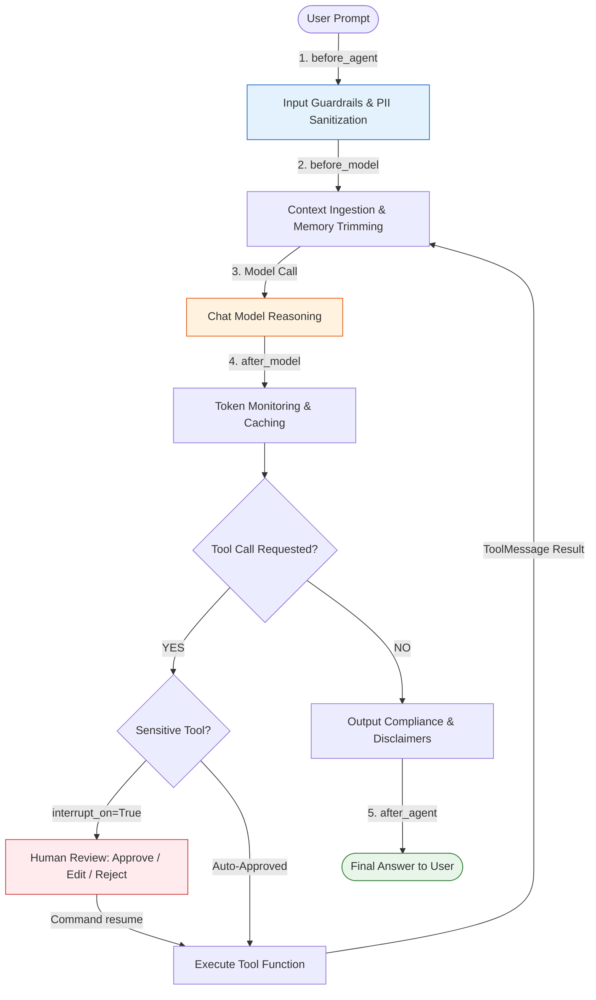

# LangChain Learning Curriculum 🦜🔗

[](https://www.python.org/)
[](https://python.langchain.com/)
[](https://langchain-ai.github.io/langgraph/)
[](https://github.com/astral-sh/uv)

> A structured, hands-on master curriculum for learning and mastering the modern **LangChain ecosystem** (LangChain 0.3+, LangGraph, and LangSmith). Covers foundational model invocations, messages, custom tools, agent loops, schema validation, persistent memory, extensible middleware, production guardrails, human approvals, retrieval-augmented generation (RAG), and LangChain Expression Language (LCEL).

---

## 📑 Table of Contents

1. [Repository Structure & Learning Roadmap](#-repository-structure--learning-roadmap)
2. [Curriculum Modules Breakdown](#-curriculum-modules-breakdown)
   - [01. Models 🧠](#1-01_models-)
   - [02. Messages 💬](#2-02_messages-)
   - [03. Tools 🔧](#3-03_tools-)
   - [04. Agents 🤖](#4-04_agents-)
   - [05. Structured Output 📐](#5-05_structured_output-)
   - [06. Short-Term Memory 💾](#6-06_memory-)
   - [07. Middleware ⚙️](#7-07_middleware-)
   - [08. Guardrails 🛡️](#8-08_guardrails-)
   - [09. Human-in-the-Loop (HITL) 👤](#9-09_human_in_the_loop-)
   - [10. RAG & Retrieval 🔍](#10-10_rag_retrieval-)
   - [11. LCEL (LangChain Expression Language) ⚡](#11-11-lcel-)
3. [Architecture & Agent Lifecycle Flow](#-architecture--agent-lifecycle-flow)
4. [Quick Reference Matrix](#-quick-reference-matrix)
5. [Getting Started & Setup](#-getting-started--setup)
   - [Prerequisites](#1-prerequisites)
   - [Environment Installation](#2-environment-installation)
   - [API Keys Configuration](#3-api-keys-configuration)
6. [QA & AI Testing Framework](#-qa--ai-testing-framework)

---

## 📁 Repository Structure & Learning Roadmap

```
langchain-learning/
│
├── 01_models/              # 🧠 Chat models, initialization, parameters, batching & providers
├── 02_messages/            # 💬 Message primitives (System, Human, AI, Tool), roles & multimodal
├── 03_tools/               # 🔧 Custom tools (@tool), Pydantic validation & ToolRuntime
├── 04_agents/              # 🤖 Agent architectures, ReAct loops & create_agent harness
├── 05_structured_output/   # 📐 Schema enforcement, Pydantic responses & auto-retries
├── 06_memory/              # 💾 Short-term thread memory, checkpointers & session management
├── 07_middleware/          # ⚙️ Custom hooks, lifecycle interception & execution logging
├── 08_guardrails/          # 🛡️ Input/output validation, PII redaction & safety barriers
├── 09_human_in_the_loop/   # 👤 Breakpoints, approvals, argument editing & human intervention
├── 10_rag_retrieval/       # 🔍 Document loaders, splitters, vector stores & RAG pipelines
└── 11-LCEL/                # ⚡ Runnables, sequence pipelines, parallel branches & LCEL for RAG
```

---

## 📚 Curriculum Modules Breakdown

### 1. [01_models](file:///c:/Users/ladvi/Software-Testing/GIT%20Repos/langchain-learning/01_models) 🧠
*Core reasoning engines and unified multi-provider chat interfaces.*
- **Unified Initialization**: Using `init_chat_model()` across providers (Google Gemini, Groq, OpenAI, Anthropic, Hugging Face).
- **Execution Patterns**: Single synchronous calls (`.invoke()`), real-time token streaming (`.stream()`), and batched processing (`.batch()`, `.batch_as_completed()`).
- **Advanced Controls**: Token usage monitoring, rate-limiting handlers, dynamic model routing, and prompt caching.
- **Resources**:
  - 📓 Notebook: [models.ipynb](file:///c:/Users/ladvi/Software-Testing/GIT%20Repos/langchain-learning/01_models/models.ipynb)
  - 📖 Revision Notes: [models_notes.md](file:///c:/Users/ladvi/Software-Testing/GIT%20Repos/langchain-learning/01_models/models_notes.md)

---

### 2. [02_messages](file:///c:/Users/ladvi/Software-Testing/GIT%20Repos/langchain-learning/02_messages) 💬
*Fundamental conversational primitives and multimodal context blocks.*
- **Message Primitives**: `SystemMessage`, `HumanMessage`, `AIMessage`, and `ToolMessage`.
- **Metadata & Attributes**: Tracking message IDs, token consumption metadata, tool call requests, and raw provider response headers.
- **Multimodal & Composite Payloads**: Bundling text, images, and audio into structured content blocks.
- **Serialization**: Saving and restoring multi-turn conversation states across sessions.
- **Resources**:
  - 📓 Notebook: [messages.ipynb](file:///c:/Users/ladvi/Software-Testing/GIT%20Repos/langchain-learning/02_messages/messages.ipynb)
  - 📖 Revision Notes: [messages_notes.md](file:///c:/Users/ladvi/Software-Testing/GIT%20Repos/langchain-learning/02_messages/messages_notes.md)

---

### 3. [03_tools](file:///c:/Users/ladvi/Software-Testing/GIT%20Repos/langchain-learning/03_tools) 🔧
*Empowering language models with deterministic, real-world execution capabilities.*
- **Tool Creation**: Defining custom tools using `@tool` with type hints and descriptive docstrings.
- **Schema Validation**: Defining strict argument schemas with Pydantic `BaseModel` and JSON Schema validation.
- **Runtime Access (`ToolRuntime`)**: Reading session state (`runtime.state`), configuration (`runtime.context`), and emitting real-time tool progress (`runtime.stream_writer`).
- **Return Types**: Returning strings, structured objects, multimodal content, and state updates via `Command`.
- **Resources**:
  - 📓 Notebook: [tools.ipynb](file:///c:/Users/ladvi/Software-Testing/GIT%20Repos/langchain-learning/03_tools/tools.ipynb)
  - 📖 Revision Notes: [tools_notes.md](file:///c:/Users/ladvi/Software-Testing/GIT%20Repos/langchain-learning/03_tools/tools_notes.md)

---

### 4. [04_agents](file:///c:/Users/ladvi/Software-Testing/GIT%20Repos/langchain-learning/04_agents) 🤖
*Autonomous reasoning loops governed by modern LangGraph harnesses.*
- **Core Formula**: $\text{Agent} = \text{Model} + \text{Harness}$.
- **ReAct Feedback Loop**: User Prompt $\rightarrow$ Model Reasoning $\rightarrow$ Tool Invocation $\rightarrow$ Observation $\rightarrow$ Final Answer.
- **Unified Factory**: Building production agents via `create_agent()`, binding tools, and specifying persona boundaries.
- **Resources**:
  - 📓 Notebook: [agents.ipynb](file:///c:/Users/ladvi/Software-Testing/GIT%20Repos/langchain-learning/04_agents/agents.ipynb)
  - 📖 Revision Notes: [agents_notes.md](file:///c:/Users/ladvi/Software-Testing/GIT%20Repos/langchain-learning/04_agents/agents_notes.md)

---

### 5. [05_structured_output](file:///c:/Users/ladvi/Software-Testing/GIT%20Repos/langchain-learning/05_structured_output) 📐
*Type-safe schema enforcement without fragile regex parsing.*
- **Enforcement Strategies**: Provider-native JSON schema validation (`ProviderStrategy`) vs tool calling fallbacks (`ToolStrategy`).
- **Supported Formats**: Pydantic models, Python dataclasses, `TypedDict`, and raw JSON schemas.
- **Error Recovery**: Automatic schema re-prompts and error correction loops on invalid model outputs.
- **Resources**:
  - 📓 Notebook: [Structuredoutput.ipynb](file:///c:/Users/ladvi/Software-Testing/GIT%20Repos/langchain-learning/05_structured_output/Structuredoutput.ipynb)
  - 📖 Revision Notes: [structured_output_notes.md](file:///c:/Users/ladvi/Software-Testing/GIT%20Repos/langchain-learning/05_structured_output/structured_output_notes.md)

---

### 6. [06_memory](file:///c:/Users/ladvi/Software-Testing/GIT%20Repos/langchain-learning/06_memory) 💾
*Short-term thread memory and conversational state persistence.*
- **Session Checkpointing**: Maintaining conversational state using `InMemorySaver` and `PostgresSaver`.
- **Thread Isolation**: Scoping memory threads using `thread_id` to run distinct, simultaneous conversations.
- **Context Window Management**: Mitigating context bloat using message trimming, deletion (`RemoveMessage`), and `SummarizationMiddleware`.
- **Resources**:
  - 📓 Notebook: [Memory.ipynb](file:///c:/Users/ladvi/Software-Testing/GIT%20Repos/langchain-learning/06_memory/Memory.ipynb)
  - 📖 Revision Notes: [short_term_memory_notes.md](file:///c:/Users/ladvi/Software-Testing/GIT%20Repos/langchain-learning/06_memory/short_term_memory_notes.md)

---

### 7. [07_middleware](file:///c:/Users/ladvi/Software-Testing/GIT%20Repos/langchain-learning/07_middleware) ⚙️
*Extensible lifecycle interception, reliability, and cross-cutting concerns.*
- **Hook Lifecycle**: Intercepting requests `before_agent`, `before_model`, `wrap_model_call`, `after_model`, `wrap_tool_call`, and `after_agent`.
- **Built-in Middleware**: Automatic retries (`ModelRetryMiddleware`), call limits (`ModelCallLimitMiddleware`), and fallback models (`ModelFallbackMiddleware`).
- **Custom Middleware**: Writing node-style hooks, wrap-style wrappers, dynamic prompts (`@dynamic_prompt`), and class-based `AgentMiddleware`.
- **Resources**:
  - 📓 Notebook: [middleware.ipynb](file:///c:/Users/ladvi/Software-Testing/GIT%20Repos/langchain-learning/07_middleware/middleware.ipynb)
  - 📖 Middleware Notes: [middleware_notes.md](file:///c:/Users/ladvi/Software-Testing/GIT%20Repos/langchain-learning/07_middleware/middleware_notes.md)
  - 📖 HITL Middleware Notes: [hitl_middleware_notes.md](file:///c:/Users/ladvi/Software-Testing/GIT%20Repos/langchain-learning/07_middleware/hitl_middleware_notes.md)

---

### 8. [08_guardrails](file:///c:/Users/ladvi/Software-Testing/GIT%20Repos/langchain-learning/08_guardrails) 🛡️
*Input/output safety barriers, content moderation, and PII sanitization.*
- **Defense in Depth**: Inexpensive deterministic regex checks paired with model-based semantic evaluators.
- **PII Detection**: Redacting, masking, hashing, and blocking sensitive data (emails, credit cards, API keys) via `PIIMiddleware`.
- **Boundary Validation**: Validating inputs before LLM reasoning (`before_agent`) and enforcing compliance disclaimers on outputs (`after_agent`).
- **Resources**:
  - 📓 Notebook: [guardrails.ipynb](file:///c:/Users/ladvi/Software-Testing/GIT%20Repos/langchain-learning/08_guardrails/guardrails.ipynb)
  - 📖 Revision Notes: [guardrails_notes.md](file:///c:/Users/ladvi/Software-Testing/GIT%20Repos/langchain-learning/08_guardrails/guardrails_notes.md)

---

### 9. [09_human_in_the_loop](file:///c:/Users/ladvi/Software-Testing/GIT%20Repos/langchain-learning/09_human_in_the_loop) 👤
*Human-directed authorizations, breakpoints, and parameter editing.*
- **Approval Policy**: Intercepting sensitive side-effect tools (transfers, deletions, emails) via `HumanInTheLoopMiddleware(interrupt_on={...})`.
- **Decision Primitives**: Four built-in actions: `approve` (proceed), `edit` (modify parameters), `reject` (cancel with feedback), and `respond` (synthetic result).
- **State Resumption**: Pausing graph execution cleanly via checkpointers and continuing with `Command(resume=...)`.
- **Resources**:
  - 📖 Revision Notes: [human_in_the_loop_notes.md](file:///c:/Users/ladvi/Software-Testing/GIT%20Repos/langchain-learning/09_human_in_the_loop/human_in_the_loop_notes.md)

---

### 10. [10_rag_retrieval](file:///c:/Users/ladvi/Software-Testing/GIT%20Repos/langchain-learning/10_rag_retrieval) 🔍
*Grounding language models with external knowledge bases and vector search.*
- **The Retrieval Pipeline**: Ingestion path (Loaders $\rightarrow$ Splitters $\rightarrow$ Embeddings $\rightarrow$ Vector Stores) vs. Online query path.
- **Chunking & Indexing**: Text splitting with `RecursiveCharacterTextSplitter`, chunk overlap tuning, and FAISS indexing.
- **Architectures**: 2-Step (Naive) RAG, Agentic RAG (`create_retriever_tool`), and Hybrid / Corrective RAG.
- **QA & Evaluation**: The RAG Triad (Context Relevance, Faithfulness/Groundedness, Answer Relevance), Recall@k, and automated regression datasets.
- **Resources**:
  - 📓 Notebook: [Basic_RAG.ipynb](file:///c:/Users/ladvi/Software-Testing/GIT%20Repos/langchain-learning/10_rag_retrieval/Basic_RAG.ipynb)
  - 📖 Revision Notes: [rag_retrieval_notes.md](file:///c:/Users/ladvi/Software-Testing/GIT%20Repos/langchain-learning/10_rag_retrieval/rag_retrieval_notes.md)
  - 📄 Sample Data: [leave_policy.txt](file:///c:/Users/ladvi/Software-Testing/GIT%20Repos/langchain-learning/10_rag_retrieval/data/leave_policy.txt)

---

### 11. [11-LCEL](file:///c:/Users/ladvi/Software-Testing/GIT%20Repos/langchain-learning/11-LCEL) ⚡
*Declarative chain composition with LangChain Expression Language.*
- **Pipe Syntax (`|`)**: Chaining prompts, models, parsers, and retrievers into clean pipelines.
- **Core Runnables**: `RunnableSequence`, `RunnableParallel` (concurrent branches), `RunnablePassthrough`, `RunnableLambda` (custom Python callables), and `RunnableBranch` (routing).
- **LCEL for RAG**: Idiomatic composition for passing queries, formatting retrieved documents, and preserving questions.
- **Execution Interface**: Standard support for `invoke()`, `batch()`, `stream()`, and async counterparts.
- **Resources**:
  - 📓 Notebook: [lcel.ipynb](file:///c:/Users/ladvi/Software-Testing/GIT%20Repos/langchain-learning/11-LCEL/lcel.ipynb)
  - 📖 Revision Notes: [lcel_notes.md](file:///c:/Users/ladvi/Software-Testing/GIT%20Repos/langchain-learning/11-LCEL/lcel_notes.md)

---

## 🏛️ Architecture & Agent Lifecycle Flow



---

## 📊 Quick Reference Matrix

| # | Module | Key Primitives | Main Purpose |
| :-: | :--- | :--- | :--- |
| **01** | **Models** 🧠 | `init_chat_model`, `invoke`, `stream`, `batch` | Unified chat model access & multi-provider integrations |
| **02** | **Messages** 💬 | `SystemMessage`, `HumanMessage`, `AIMessage`, `ToolMessage` | Structured conversational memory & multimodal content |
| **03** | **Tools** 🔧 | `@tool`, `BaseModel`, `Field`, `ToolRuntime` | Callable functions allowing agents to interact with external tools |
| **04** | **Agents** 🤖 | `create_agent`, ReAct loop, `system_prompt` | Autonomous reasoning loops executing tools until completion |
| **05** | **Structured Output** 📐 | `.with_structured_output()`, `ProviderStrategy`, `ToolStrategy` | Type-safe JSON/Pydantic validation with auto-retry |
| **06** | **Memory** 💾 | `InMemorySaver`, `PostgresSaver`, `thread_id` | Thread-scoped conversational history & state persistence |
| **07** | **Middleware** ⚙️ | `ModelRetryMiddleware`, `ModelFallbackMiddleware`, `@before_model` | Lifecycle hooks for observability, retries, and rate limits |
| **08** | **Guardrails** 🛡️ | `PIIMiddleware`, `before_agent`, `after_agent` | Safety barriers, PII redaction, and prompt injection defense |
| **09** | **Human-in-the-Loop** 👤 | `HumanInTheLoopMiddleware`, `interrupt_on`, `Command` | Breakpoints, human approvals, and parameter modifications |
| **10** | **RAG & Retrieval** 🔍 | `FAISS`, `RecursiveCharacterTextSplitter`, `HuggingFaceEmbeddings` | Ingestion, vector similarity search, and evidence grounding |
| **11** | **LCEL** ⚡ | `|`, `RunnableParallel`, `RunnablePassthrough`, `RunnableLambda` | Declarative, streaming, and batched pipeline composition |

---

## 🚀 Getting Started & Setup

### 1. Prerequisites
- **Python 3.12+**
- **[uv](https://github.com/astral-sh/uv)** (Recommended fast package manager) or standard `pip`

### 2. Environment Installation

Clone the repository and install all dependencies:

```bash
# Clone the repository
git clone <repo-url>
cd langchain-learning

# Using uv (fastest & recommended)
uv sync

# Activate the virtual environment
# Windows (PowerShell):
.venv\Scripts\activate

# Linux / macOS:
source .venv/bin/activate
```

*Alternatively, using standard pip:*
```bash
pip install -r requirements.txt
```

### 3. API Keys Configuration

Create a `.env` file in the project root:

```env
# Primary Model Providers
GOOGLE_API_KEY=your_google_genai_api_key
GROQ_API_KEY=your_groq_api_key
OPENAI_API_KEY=your_openai_api_key
HUGGINGFACEHUB_API_TOKEN=your_huggingface_token

# LangSmith Tracing & Observability (Optional)
LANGCHAIN_TRACING_V2=true
LANGCHAIN_API_KEY=your_langsmith_api_key
LANGCHAIN_PROJECT=langchain-learning
```

---

## 🧪 QA & AI Testing Framework

Every topic in this curriculum includes targeted **Quality Assurance (QA) and AI Testing** patterns:
- **Unit Testing Deterministic Tools**: Validating type signatures, edge-case arguments, and Pydantic schemas.
- **State Isolation Testing**: Verifying thread boundaries to ensure user data never leaks across sessions.
- **Security & Adversarial Testing**: Stress-testing agents with prompt injections, system override directives, and PII leakage payloads.
- **RAG Evaluation Triad**:
  1. *Context Relevance*: Measuring retrieval precision and recall over document chunks.
  2. *Groundedness (Faithfulness)*: Detecting model hallucinations using LLM-as-a-judge evaluators.
  3. *Answer Relevance*: Asserting that completions directly and completely address user queries.
